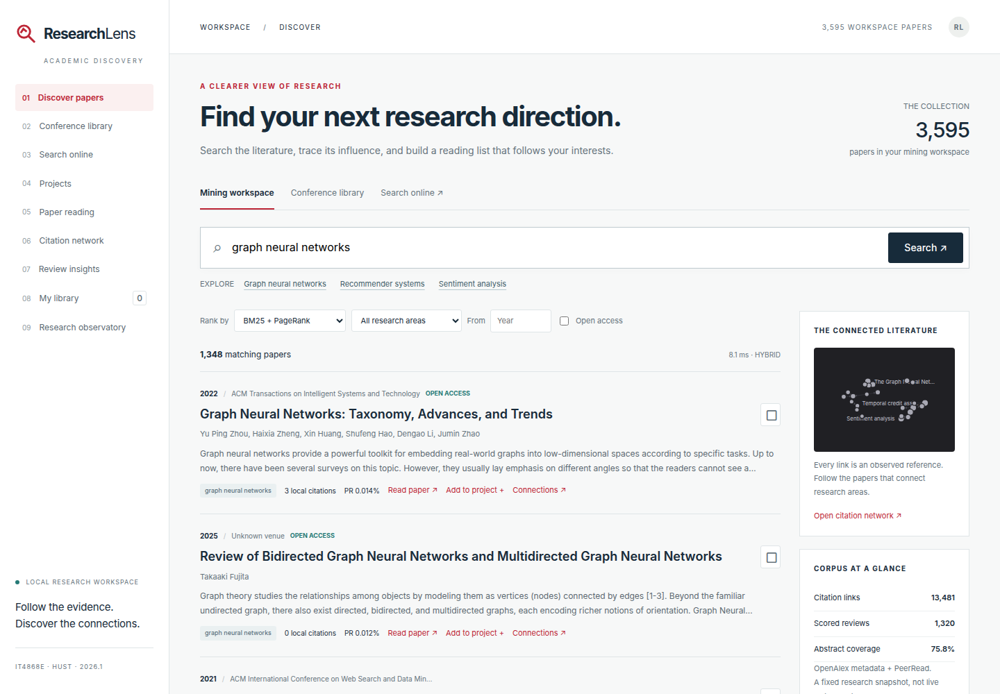

# ResearchLens

**Intelligent Research Paper Search and Discovery System** — đồ án IT4868E, HUST, học kỳ 2026.1.

Hệ thống chạy local với **129.596 bản ghi hội nghị (2020–2026)** và tìm kiếm OpenAlex trực tuyến. Snapshot thí nghiệm riêng gồm **3.595 paper, 13.481 cạnh citation, 1.320 scored reviews duy nhất**. Bài toán chính: từ các bài đã lưu, gợi ý bài nên đọc tiếp. Search là cách lưu bài đầu tiên, review là bằng chứng cạnh gợi ý.

**Kết quả chính.** My library mặc định dùng **AI decision model**: gradient boosting học từ 2.081 tác vụ tự sinh trên các mốc 2010–2018, xếp hạng ứng viên bằng 10 tín hiệu đồ thị, nội dung và SPECTER. Khi người dùng nhập Topic, BM25 lấy thêm ứng viên theo đề tài và một mô hình riêng xếp hạng lại. Bản có đề tài cho ít nhất một bài đúng trong 10 gợi ý (Hit@10) ở **64%, 58% và 78%** số tác vụ của ba phép thử, so với 58%, 42% và 71% của fusion; nDCG@10 0,237, 0,182 và 0,304, vượt fusion có ý nghĩa thống kê ở cả ba. Fusion cộng nghịch đảo hạng đồng trích dẫn và hạng hybrid, k=60, và là phương án dự phòng. Trên 219 bài test sau mốc 2020, fusion đạt nDCG@10 0,207, đồng trích dẫn 0,173, hybrid 0,143. Trên split che ngẫu nhiên 120 bài, fusion 0,259 vẫn hơn hybrid 0,112 nhưng kém đồng trích dẫn 0,305. Bản không có đề tài đạt 0,224, 0,132 và 0,297. Xem [audit, điều kiện thí nghiệm và kịch bản demo](docs/CAPSTONE_AUDIT.md).

Phiếu thử “bạn có lưu bài này để đọc tiếp không?” dùng được offline. Xem [phiếu chấm](evaluation/reading-study/annotate.html) và [pilot mô hình quyết định, tình trạng nhãn người thật](evaluation/reading-study/README.md).

Đã đo riêng khả năng tìm bài cùng phương pháp trên 1.218 cặp CSFCube do chuyên gia chấm. Điểm nDCG@10 là 0,233 với Laya trực tiếp, 0,339 khi kết hợp Laya với tín hiệu văn bản, và 0,365 khi chỉ dùng TF-IDF + MiniLM. [Cách chạy hai chế độ và các giới hạn của kết quả](evaluation/decision-study/README.md).

Trong thí nghiệm tìm từ một câu có tên kỹ thuật, kết hợp Reader với BM25 tăng số truy vấn có bài đúng trong top 3 từ 69 lên 83 trên 172 câu SciERC. Khi che tên, hai cách đạt 20 và 19 câu. [So sánh với cross-encoder và decision model trên ba bộ dữ liệu](evaluation/decision-study/method_findings.md).

Trong **Paper reading**, mở **Find papers from a sentence in this abstract**, chọn câu muốn tìm hiểu rồi bấm **Find similar papers**. Mỗi gợi ý cho xem một câu nguyên văn của bài đích. Chọn **Find more like this paper** để lấy thêm ba bài dựa trên câu ban đầu và bài bạn thích. **Show next three** mở ba bài kế tiếp trong danh sách gốc. Chỉ mục đóng gói sẵn bao phủ 18.562 câu từ 2.725 bài có abstract, chạy local bằng NumPy. [Thí nghiệm và cách tái tạo](evaluation/decision-study/README.md#tìm-từ-một-câu-trong-trình-đọc).



## Chạy ngay

Yêu cầu Python 3.11+ và [uv](https://docs.astral.sh/uv/). Snapshot đã có trong `data/`; không cần API key, GPU hay dịch vụ mô hình sinh để chạy.

```bash
uv sync --frozen --extra dev
uv run uvicorn researchlens.api:app --host 127.0.0.1 --port 8765
```

Mở **http://127.0.0.1:8765**. API reference offline: `/docs`; OpenAPI: `/openapi.json`.

Hoặc Docker:

```bash
docker compose up -d --build app
```

Cổng host mặc định 8765; đổi bằng `APP_PORT=8766 docker compose up -d app`. Thư viện lưu trong named volume `researchlens-state`; `docker compose down` giữ volume. Đừng thêm `--volumes` nếu muốn giữ thư viện.

## Tính năng đã triển khai

- **Conference library:** ICML, NeurIPS, ICLR, AAAI, EMNLP, NAACL, ACL, CVPR; FTS5/BM25, lọc hội nghị/năm và bảng coverage.
- **Search online:** OpenAlex live search, preview nguồn thật, Import & read; paper import dùng được trong Project, reader và citation graph.
- **Discover:** BM25, TF-IDF cosine, BM25 + PageRank, global PageRank; query phrase, AND, OR mặc định, `-excluded`; lọc năm, chủ đề, venue qua API và open access; phân trang.
- **Paper details / extraction:** metadata, TF-IDF keywords, pattern-based method/dataset/DOI/arXiv mentions với offset; citation metrics; nguồn bài và review liên kết.
- **Projects:** brief đề tài, gợi ý BM25, thêm/bỏ paper, tiến độ đọc, lọc trạng thái, citation map riêng và xuất notes JSON.
- **Paper reading:** PDF thật trong trình duyệt, ghi chú tự lưu và khôi phục draft, bookmark trang, focus mode, citation graph và liên kết paper liên quan. PDF lỗi/không hỗ trợ có abstract fallback rõ ràng.
- **Citation network:** phong cách Obsidian, node kéo thả có lực lò xo kéo các node liên kết cùng chuyển động, pan/zoom, tìm theo tiêu đề, highlight neighborhood, nhóm Louvain, bật/tắt nhãn; hướng cạnh citing → cited.
- **Motion:** chuyển cảnh/panel nhẹ, graph xuất hiện có giới hạn; hỗ trợ reduced motion. Áp dụng hướng dẫn UI/UX từ evondevKit; provenance và quyết định thiết kế ở [`docs/WORKSPACE_DESIGN.md`](docs/WORKSPACE_DESIGN.md).
- **Review insights:** review thật từ PeerRead, rating-derived polarity, TF-IDF + logistic regression, aspect lexicon với câu evidence và xử lý phủ định cục bộ.
- **My library:** lưu bền theo profile trình duyệt, xuất BibTeX/JSON; AI decision model (mặc định, ô Topic tùy chọn, 85 ms ở trung vị)/fusion/content/PPR/hybrid/co-citation/popularity recommendations, nút **Explain with AI** (SLM + RAG: Qwen2.5-0.5B qua llama.cpp tóm tắt abstract của gợi ý trong khoảng 0,4 s; cài bằng `make slm`), MMR diversity, cold start, lý do gợi ý.
- **Observatory:** thống kê dữ liệu, kết quả thí nghiệm thật, phạm vi và giới hạn của từng metric.

PDF reader cần mạng và trình duyệt hỗ trợ PDF; metadata/search vẫn chạy offline. Bookmark là trang do người đọc nhập, không tự theo dõi scroll. Notes lưu trong SQLite; draft lỗi lưu localStorage với khóa theo profile/paper.

Cookie là profile ẩn danh local, không phải tài khoản đăng nhập. Không có crawler PDF/full-text hoặc NER tổng quát. Review labels là proxy từ điểm reviewer, không phải phán quyết chất lượng paper.

## Kho hội nghị và tìm kiếm online

Mở `/#catalog` để tìm trong kho hội nghị; `/#online` tìm paper ngoài kho bằng OpenAlex. Nút **Import & read** đưa paper vào mining workspace dùng chung, còn Project/notes/library riêng theo profile. Không tải hàng loạt PDF. Các năm nguồn chưa có record hiển thị 0; không tuyên bố đã có mọi accepted paper. Chi tiết nguồn, coverage và cách cập nhật ở [`docs/DISCOVERY.md`](docs/DISCOVERY.md).

```bash
uv run python scripts/crawl_conferences.py --from-year 2020 --to-year 2026 --workers 3
uv run python scripts/evaluate_catalog.py
```

Sau crawl, restart server để sync FTS; Docker cần build lại. Cache raw tái sử dụng khi chạy lại. API key OpenAlex tùy chọn đặt phía server qua `OPENALEX_API_KEY`; provider hết quota có lỗi rõ ràng. App chạy một Uvicorn process để giữ engine import đồng bộ.

Phép đo riêng trên 129.596 record: **p50 44,2 ms; p95 153,2 ms** cho 100 warm queries, không gồm HTTP/browser. Chưa có relevance labels cho kho này. Snapshot và thí nghiệm gốc giữ nguyên; Solr chỉ index snapshot gốc, không tự nhận paper import.

## Apache Solr / Lucene

Backend mặc định là sparse retrieval trong Python để chạy nhẹ, thuận tiện đối chiếu thuật toán. Có thêm **Apache Solr 9.9.0**, đã chạy integration trên toàn corpus:

```bash
docker compose --profile solr up -d solr
# Đợi healthcheck báo healthy:
docker compose ps
uv run python scripts/solr_index.py
SOLR_URL=http://127.0.0.1:8983/solr/researchlens \
  uv run uvicorn researchlens.api:app --host 127.0.0.1 --port 8765
```

Dropdown ranking sẽ có **Apache Solr · snapshot**. Với app chạy trong Docker:

```bash
SOLR_URL=http://solr:8983/solr/researchlens docker compose --profile solr up -d app solr
```

Dùng core `researchlens` riêng: script index **thay toàn bộ dữ liệu của core đã cấu hình**. Chạy lại index sau khi đổi corpus. Solr `text_en` có stemming, khác tokenizer local; không kỳ vọng hai backend trả thứ tự giống nhau. Số benchmark trong báo cáo là implementation local, không phải benchmark Solr. Integration evidence: `artifacts/solr_integration.json`.

## Kết quả thực nghiệm

| Tác vụ | Phương pháp | Kết quả |
|---|---|---:|
| SciFact retrieval, 300 test queries | TF-IDF / BM25 | nDCG@10 0,621 / **0,651** |
| Reference recovery sau 2020, 219 bài | Hybrid / Đồng trích dẫn / Fusion | nDCG@10 0,143 / 0,173 / **0,207** |
| Reference recovery ngẫu nhiên, 120 profiles | Content / PPR / Hybrid / Hybrid+MMR | nDCG@10 0,063 / **0,174** / 0,112 / 0,129 |
| PeerRead, 115 test reviews | Majority / Lexicon / Logistic regression | Macro-F1 0,181 / 0,436 / **0,469** |

Hybrid vượt content (paired nDCG delta 0,0489; bootstrap 95% CI [0,0274; 0,0734]), **chưa vượt PPR**. Review model và lexicon có khoảng tin cậy chồng lấn; không tuyên bố ưu thế có ý nghĩa thống kê. Citation recovery là proxy, chưa đo user satisfaction hoặc dự báo tương lai.

```bash
# Lần đầu tải SciFact nếu chưa có cache; giữ nguyên snapshot để tái lập số hiện tại.
uv run python scripts/evaluate.py --tasks 120
uv run python scripts/figures.py
uv run python scripts/verify_artifacts.py
```

Protocol: random seed 42; 442 held-out citation edges bị xóa **trước** mọi graph score; seed/source papers bị loại khỏi candidates; official paper-disjoint review split; train-only vocabulary/model; bootstrap theo query/source paper và cluster bootstrap theo review paper. Không tune trên test. Trong benchmark, popularity/content/graph/hybrid dùng diversity=0; riêng hybrid+MMR dùng 0,15. Giao diện cho phép đổi diversity, nên đặt về 0 khi đối chiếu các baseline. Các kết quả từng quan sát và split đều được lưu trong `artifacts/`.

## Kiểm thử và audit

```bash
uv run pytest -q --cov=researchlens --cov-report=term-missing
# Chạy khi server local đang ở port 8765; cần Chromium của Playwright:
uv run playwright install chromium
uv run python scripts/browser_qa.py
# Cần mạng để kiểm tra PDF arXiv thật:
uv run python scripts/workspace_qa.py
uv run python scripts/graph_qa.py
# Discovery QA dùng OpenAlex thật và import; nên chạy server với DB tạm trên port 8767:
RESEARCHLENS_BASE_URL=http://127.0.0.1:8767 uv run python scripts/discovery_qa.py
```

Suite hiện tại có **577 tests đạt**, gồm kiểm thử chỉ mục, kiểm tra mọi con số gợi ý trong report khớp với artifact, thứ hạng, câu trích, phản hồi trang hai và tách tập đánh giá theo bài mẫu. Package researchlens đạt khoảng 99% statement coverage trong lần chạy này. Xem [`docs/TEST_REPORT.md`](docs/TEST_REPORT.md) và [`docs/AUDIT.md`](docs/AUDIT.md). Browser QA kiểm tra desktop/mobile, search, save, details, graph, review analysis, recommendations và export. Browser QA mới kiểm tra Project, PDF arXiv thật, notes tiếng Việt >64 KiB, draft recovery, graph controls và reduced motion. Kết quả nằm ở `artifacts/browser_qa.json` và `artifacts/workspace_qa.json`; ảnh trong `artifacts/screenshots/`.

## Report và slide

- [`deliverables/ResearchLens_Report.pdf`](deliverables/ResearchLens_Report.pdf): báo cáo tiếng Việt, nguồn LaTeX ở `report/`.
- [`deliverables/ResearchLens_Slides.pdf`](deliverables/ResearchLens_Slides.pdf): 27 slide Beamer, dùng template **HUST_THEME_BEAMER.zip**; nguồn ở `slides/`.
- Tên nhóm, thành viên, MSSV: sửa **`report/metadata.tex`**, dùng chung cả hai tài liệu. Thông tin cá nhân để bổ sung sau theo yêu cầu.

Biên dịch cần XeLaTeX, latexmk, BibTeX, các gói TeX Live thường dùng và font **Noto Serif, Noto Sans, DejaVu Sans Mono**:

```bash
make documents
```

Chart vector PDF/PNG được sinh từ số liệu đo. Screenshot được chụp từ app; không dùng ảnh minh họa sinh bằng AI. Nguồn gốc HUST theme được giữ trong `slides/hust/beamerthemeHUST.sty`.

## Dữ liệu và nguồn

`ResearchLens_Visual_Spec.pdf` và `20261_syllabus.pdf` được đọc để chốt scope. Collector ở `scripts/collect.py` lấy OpenAlex theo 8 queries × 400 kết quả, English, publication date ≤ 2025-12-31; hợp với PeerRead ICLR 2017 tại commit cố định. Tên paper được exact normalized-title join; chưa có fuzzy entity resolution. Corpus mới có thể khác do upstream thay đổi.

```bash
# Tùy chọn thu thập lại; không cần cho demo với snapshot hiện có.
uv run python scripts/collect.py --per-topic 400
# Có thể đặt OPENALEX_API_KEY nếu cần hạn mức lớn hơn.
```

Raw cache, checksum và provenance có ở `data/raw/` và `data/provenance.json`. OpenReview live API yêu cầu xác minh trong lần chạy này, nên benchmark dùng PeerRead công khai; không giả dữ liệu hoặc bypass challenge. Nguồn arXiv trong visual spec chưa có crawler độc lập ở phiên bản này.

Tham khảo và điều kiện sử dụng upstream: [OpenAlex API](https://help.openalex.org/api/), [PeerRead repository](https://github.com/allenai/PeerRead), [PeerRead paper](https://aclanthology.org/N18-1149/), [BEIR](https://github.com/beir-cellar/beir), [SciFact](https://aclanthology.org/2020.emnlp-main.609/). Dữ liệu bên thứ ba giữ điều kiện của nguồn; không gán giấy phép mã nguồn của dự án cho review/abstract hoặc HUST assets.

## Cấu trúc

```text
researchlens/        API, thuật toán, storage, review model, Solr, UI
scripts/             collect, evaluate, figures, browser QA, verify, Solr index
tests/              unit + isolated API tests do agent độc lập viết
data/               normalized snapshot, provenance, raw cache, SciFact
artifacts/          measured results, per-query scores, splits, charts, screenshots
report/             báo cáo LaTeX + tài liệu tham khảo + metadata
slides/             HUST Beamer + template nguyên bản
deliverables/       PDF cuối
docs/               audit và test report
```

Các endpoint chính: `/api/search`, `/api/papers/{id}`, `/api/graph`, `/api/recommendations`, `/api/opinion`, `/api/extract`, `/api/library`, `/api/library/export`, `/api/stats`, `/api/experiments`. Trình đọc lấy các câu qua `GET /api/papers/{id}/passages` và ba kết quả qua `GET /api/papers/{id}/passage-matches?sentence=2` (đánh số từ 0). Request bodies và validation đầy đủ trong OpenAPI.
